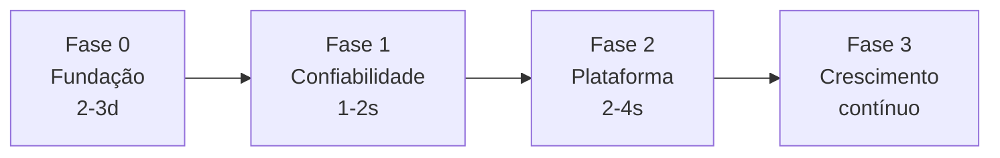

# Roadmap

> Status: `v0.1.0` público (Apache-2.0). Fase 0 concluída; Fase 1 em implementação.

## Fase 0 — Fundação

- [x] Sanitização + LICENSE canônico + `.env.example`
- [x] `SECURITY.md` + `CONTRIBUTING.md` + issue/PR templates
- [x] `gitleaks` + custom block (`truuz`/`Lotuz*`/IDs)
- [x] `dependabot.yml`
- [x] `Makefile` + `scripts/check-env.py`
- [ ] `gitleaks` pre-commit hook docs (opcional)

## Fase 1 — Confiabilidade (em andamento)

- [ ] `Uptime Kuma` atrás de Cloudflare Access (`kuma.example.com`) — container loopback ativo; Access/ingress pendentes
- [x] Backup 2.0: `age` encryption obrigatório + Healthchecks.io opcional + alerta de backup > 48h
- [x] Cronova `secure_cookie: true`
- [ ] Supabase Studio/Cronova via Cloudflare Access; Docker-aware firewall for ports `8000`, `5432`, `6543`
- [x] `scripts/restore-test.sh` instalado e agendado semanalmente; restore smoke passou em banco Supabase temporário
- [x] `docs/disaster-recovery.md` com runbook de backup, restore e rollout

## Fase 2 — Plataforma

- [ ] `docker-compose.lotuz.yml` unificado com `profiles: [crm, flow, wa, mkt]`
- [ ] `Hermes TUI` via tunnel `hermes.example.com` + Telegram gateway
- [ ] Webhook gateway único `POST /hook/:service` → Cronova/AgentSDR
- [ ] Skills SDK: `skills/lotuz/*/SKILL.md` + `hermes skills test`
- [ ] `scripts/setup.sh --yes` idempotente (substitui `docs/deploy-*.md` manual)

## Fase 3 — Crescimento
- [ ] Docs site `mkdocs` + GitHub Pages + diagrama + GIF demo (sem domínio real)
- [ ] `good first issue` backlog
- [ ] Marketplace de skills (`lotuz-reports` com sheets)

---

Prioridades:

| Prioridade | Item | Esforço | Impacto |
|---|---|---|---|
| P0 | Uptime Kuma + Access | 4h | alto |
| P0 | Backup restore drill | 1d | alto |
| P1 | Compose unificado + make | 1d | médio |
| P1 | `check-env` + `age` | 4h | médio |
| P2 | Webhook gateway | 2d | médio |
| P2 | Docs site | 1d | médio |
| P3 | Hermes TUI/Telegram | 1w | baixo |

Contribuições: veja `CONTRIBUTING.md`. Para propor item novo, abra issue com label `enhancement`.
