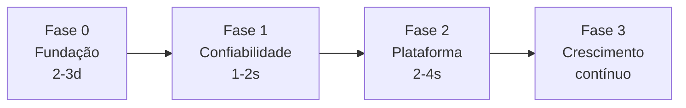

# Roadmap

> Status: `v0.1.0` público (Apache-2.0). Foco atual: **Fase 0 — Fundação**.

## Fase 0 — Fundação

- [x] Sanitização + LICENSE canônico + `.env.example`
- [x] `SECURITY.md` + `CONTRIBUTING.md` + issue/PR templates
- [x] `gitleaks` + custom block (`truuz`/`Lotuz*`/IDs)
- [x] `dependabot.yml`
- [x] `Makefile` + `scripts/check-env.py`
- [ ] `gitleaks` pre-commit hook docs (opcional)

## Fase 1 — Confiabilidade (próxima)

- [ ] `Uptime Kuma` atrás de Cloudflare Access (`kuma.example.com`)
- [ ] Backup 2.0: `age` encryption + weekly `restore --dry-run` + alerta se `rclone lsd` vazio > 48h
- [ ] Hardening: `cronova secure_cookie: true`, `Studio`/`Cronova` via Access, `UFW` audit
- [ ] `docs/disaster-recovery.md` — R2 → VM limpa < 30min (testado)
- [ ] Healthchecks.io ping no fim do `backup-r2.sh`

## Fase 2 — Plataforma

- [ ] `docker-compose.lotuz.yml` unificado com `profiles: [crm, flow, wa, mkt]`
- [ ] `Hermes TUI` via tunnel `hermes.example.com` + Telegram gateway
- [ ] Webhook gateway único `POST /hook/:service` → Cronova/AgentSDR
- [ ] Skills SDK: `skills/lotuz/*/SKILL.md` + `hermes skills test`
- [ ] `scripts/setup.sh --yes` idempotente (substitui `docs/deploy-*.md` manual)

## Fase 3 — Crescimento
- [ ] Docs site `mkdocs` + GitHub Pages + diagrama + GIF demo (sem domínio real)
- [ ] `good first issue` backlog
- [ ] Marketplace de skills (`lotuz-reports` com sheets)

---

Prioridades:

| Prioridade | Item | Esforço | Impacto |
|---|---|---|---|
| P0 | Uptime Kuma + Access | 4h | alto |
| P0 | Backup restore drill | 1d | alto |
| P1 | Compose unificado + make | 1d | médio |
| P1 | `check-env` + `age` | 4h | médio |
| P2 | Webhook gateway | 2d | médio |
| P2 | Docs site | 1d | médio |
| P3 | Hermes TUI/Telegram | 1w | baixo |

Contribuições: veja `CONTRIBUTING.md`. Para propor item novo, abra issue com label `enhancement`.
