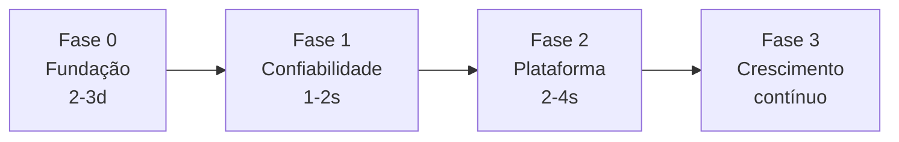

# Roadmap

> Status: `v0.1.0` público (Apache-2.0). Fase 0 concluída; Fase 1 em implementação.

## Fase 0 — Fundação

- [x] Sanitização + LICENSE canônico + `.env.example`
- [x] `SECURITY.md` + `CONTRIBUTING.md` + issue/PR templates
- [x] `gitleaks` + custom block (`truuz`/`Lotuz*`/IDs)
- [x] `dependabot.yml`
- [x] `Makefile` + `scripts/check-env.py`
- [ ] `gitleaks` pre-commit hook docs (opcional)

## Fase 1 — Confiabilidade (pendências externas)

- [ ] Uptime Kuma atrás de Cloudflare Access — Access ainda não habilitado na conta; Kuma loopback saudável
- [x] Backup 2.0: `age` encryption obrigatório + Healthchecks.io opcional + alerta de backup > 48h
- [x] Cronova `secure_cookie: true`
- [x] Supabase `8000`, `5432`, `6543` restritas a loopback; Docker-aware firewall/SSH externo ainda pendente
- [x] `scripts/restore-test.sh` instalado e agendado semanalmente; restore smoke passou em banco Supabase temporário
- [x] `docs/disaster-recovery.md` com runbook de backup, restore e rollout

## Fase 2 — Plataforma (em andamento)

- [x] Orquestrador host `scripts/lotuz` para os Compose existentes; sem recriação automática de volumes
- [x] `scripts/setup.sh --yes` idempotente + `scripts/skill-check.py`
- [x] Skills versionadas `skills/lotuz/{crm,sdr,wa,mkt}` com confirmação para efeitos externos
- [x] Webhook gateway Hermes com quatro rotas HMAC em loopback
- [ ] Publicar Hermes TUI/dashboard e webhooks via Cloudflare Access — Access ainda desabilitado na conta
- [ ] Telegram gateway — requer bot token real, ausente por design
- [ ] Webhook adapters específicos para Cronova/AgentSDR — HMAC base está pronto; payloads dependem dos contratos externos

## Fase 3 — Crescimento
- [ ] Docs site `mkdocs` + GitHub Pages + diagrama + GIF demo (sem domínio real)
- [ ] `good first issue` backlog
- [ ] Marketplace de skills (`lotuz-reports` com sheets)

---

Prioridades:

| Prioridade | Item | Esforço | Impacto |
|---|---|---|---|
| P0 | Uptime Kuma + Access | 4h | alto |
| P0 | Backup restore drill | 1d | alto |
| P1 | Compose unificado + make | 1d | médio |
| P1 | `check-env` + `age` | 4h | médio |
| P2 | Webhook gateway | 2d | médio |
| P2 | Docs site | 1d | médio |
| P3 | Hermes TUI/Telegram | 1w | baixo |

Contribuições: veja `CONTRIBUTING.md`. Para propor item novo, abra issue com label `enhancement`.
